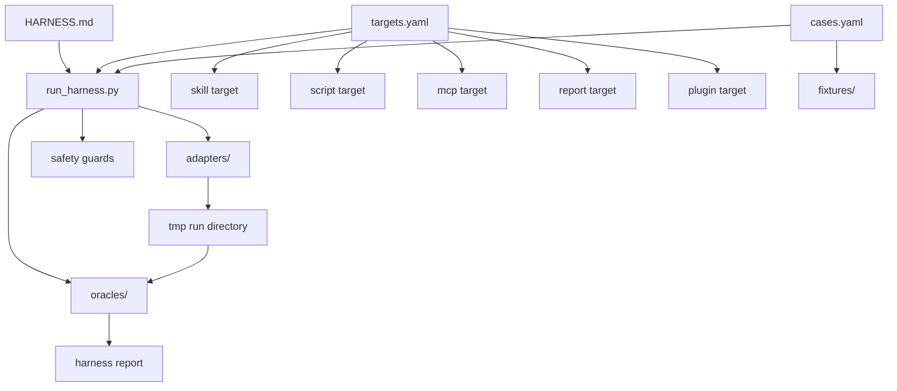

# Quant Research Reliability Harness

## Purpose

This project-local harness verifies whether Quantification research workflows
remain reliable after skill, script, schema, data-source, or report changes.

It is not a business-analysis skill. It does not answer market questions such
as "what should I buy" or "how does semiconductor look today". It tests whether
the systems that produce those research answers still behave safely under
known-good, known-bad, and cross-system contract scenarios.

The first protected domain is finance research reliability inside:

```text
${QUANTIFICATION_ROOT}
```

The harness is intentionally registry-driven. The runner must not hard-code the
current three finance skills. New skills, MCP probes, scripts, plugins, report
audits, or agent workflows should be added by registering targets and cases.

## Protected Systems

Currently active protected system:

- `capital-flow-attribution`: point-in-time source coverage, ETF/margin
  accounting identities, missing-input refusal, and evidence-state discipline.

Disabled systems retained only for explicit upgrade testing:

- `stock-relative-dominance`: relative strength, drawdown, pairwise dominance,
  ranking, and report output stability. State: `needs_upgrade`.
- `a-share-capital-flow-monitor`: capital-flow freshness, coverage,
  stale-data handling, divergence reporting, and output location safety. State:
  `pending_replacement`.
- `a-share-risk-warning-event-study`: event schema, reaction-date rules,
  price coverage, matched cases, event windows, and conclusion strength.
  State: `needs_upgrade`.

Future protected systems may include:

- `portfolio-analysis`
- `finance-news-structuring`
- `quant_data` MCP
- `quant-workbench` plugin
- report-safety audits for human-written or generated finance reports
- agent workflow checks for researcher/reviewer/qa role separation

## Non-Goals

This harness must not:

- make investment recommendations;
- produce formal market research reports for real use;
- fetch live data by default;
- write into skill folders;
- edit `skills-inventory.md`;
- move, archive, delete, or merge skills;
- package plugins;
- install dependencies;
- treat a generated dashboard or smoke report as source of truth;
- hide data-quality failures behind a successful exit code.

## Architecture



Core layers:

- `HARNESS.md`: intent, boundaries, extension rules, and report contract.
- `targets.yaml`: registry of systems that can be tested.
- `cases.yaml`: registry of test scenarios and assertions.
- `adapters/`: target-specific execution shims. The runner calls adapters
  through a common interface instead of knowing each system directly.
- `oracles/`: assertions that judge outputs, schemas, reports, and safety
  behavior.
- `fixtures/`: golden, failure, and contract input data.
- `contracts/`: reusable schemas and field-level output contracts.
- `tmp`: run-specific smoke outputs.
- `reports`: durable harness reports.

## Registry Model

Targets answer "what can be tested".

Cases answer "which scenario should be tested against which target".

Adapters answer "how to run this kind of target".

Oracles answer "what result is acceptable".

This separation keeps the harness extensible:

```text
new skill  -> add target + cases
new MCP    -> add mcp adapter + target + cases
new schema -> add contract + assertion
new report safety rule -> add oracle + cases
```

The runner should stay boring and stable. It should load registries, create a
safe run directory, call adapters, collect artifacts, execute assertions, and
write a report.

## Modes

### quick

Use for ordinary changes.

- Offline only.
- Uses small fixtures.
- Writes only to a run-specific temp directory and the final harness report.
- No live API dependency.
- Intended to finish quickly.

### full

Use after larger changes.

- Includes quick checks.
- Runs all golden, failure, and contract cases.
- May generate larger smoke outputs under the harness temp root.
- Still offline by default.

### live

Use only when explicitly requested.

- Performs small read-only online probes.
- Network/API failures are normally `REVIEW`, not hard `FAIL`, unless the
  contract says freshness is mandatory for the scenario.
- Must never write formal reports or durable caches unless the user approves.

## Status Rules

Each case produces one status:

- `PASS`: behavior matched the case contract.
- `REVIEW`: command completed, but the result needs human interpretation.
- `FAIL`: the tested system violated a reliability, schema, safety, or
  conclusion-strength contract.

Overall status:

- `FAIL` if any case is `FAIL`.
- `REVIEW` if there are no failures but at least one case is `REVIEW`.
- `PASS` only when every selected case is `PASS`.

## Assertion Families

### Schema assertions

Examples:

- required files exist;
- required CSV columns exist;
- date fields use `YYYY-MM-DD`;
- symbols use one documented canonical form;
- machine-readable files are parseable;
- missing values have reason fields when required.

### Finance assertions

Examples:

- reaction dates are trading dates;
- event-window sample size is not silently zero;
- stale capital-flow data is not treated as fresh evidence;
- pairwise dominance rankings contain all successful symbols;
- benchmark and date range are visible in the output.

### Report assertions

Examples:

- report includes data source, exact date range, sample size, and caveats;
- report does not make strong conclusions when sample size is too small;
- report does not convert historical statistics into investment advice;
- report labels generated proxy/partial evidence.

### Safety assertions

Examples:

- no output is written into a skill directory;
- smoke outputs stay under the harness temp root;
- no inventory or decision ledger is modified;
- no destructive cleanup is run without an explicit dry-run and approval.

## Implementation Status

The harness includes the minimum useful platform. Disabled skill targets are
excluded from ordinary quick/full selection but may be run explicitly by case
while upgrade work is in progress:

- `HARNESS.md`
- `targets.yaml`
- `cases.yaml`
- `run_harness.py`
- `adapters/skill_script_adapter.py`
- `adapters/report_audit_adapter.py`
- `adapters/mcp_probe_adapter.py`
- `oracles/schema_assertions.py`
- `oracles/report_assertions.py`
- `oracles/safety_assertions.py`
- `oracles/finance_assertions.py`
- reusable contracts under `contracts/`
- small offline fixtures under `fixtures/`
- active `capital_flow_attribution` good and conflict fixture cases

Live mode remains deferred until the future `quant_data` MCP exists.

## MVP Case Set

The first real cases should be small, offline, and meaningful:

- `relative_dominance_csv_contract`: verify that a local CSV relative-dominance
  run produces stable ranking and pairwise output contracts.
- `capital_flow_stale_data_failure`: verify that stale capital-flow evidence is
  downgraded instead of used for a strong conclusion.
- `event_study_missing_prices_failure`: verify that missing price coverage
  produces a data-quality warning and prevents strong event-window conclusions.
- `event_study_duplicate_announcements_contract`: verify that duplicate
  announcements are visible, deduplicated, or flagged.
- `cross_skill_symbol_date_contract`: verify shared symbol and date conventions
  across generated outputs.

## Expected Output Locations

Project files:

```text
${QUANTIFICATION_ROOT}/.agents/harnesses/quant-research-reliability/
```

Temporary run outputs:

```text
${QUANTIFICATION_ROOT}/tmp/harness/quant-research-reliability/<timestamp>/
```

Durable harness reports:

```text
${QUANTIFICATION_ROOT}/reports/harness/quant-research-reliability/
```

## Report Contract

The final harness report should include:

- generated time;
- mode;
- selected targets and cases;
- overall status;
- case table with status, adapter, artifact paths, and assertion notes;
- command table when commands are run;
- safety confirmation;
- failures and review items first;
- remaining risks.

## Extension Rules

1. Add a target to `targets.yaml` before adding cases for it.
2. Add cases to `cases.yaml`; do not hard-code case lists in the runner.
3. Add an adapter only when an existing adapter cannot run the new target type.
4. Add oracles as small reusable checks, not case-specific one-off logic.
5. Keep fixtures small and offline by default.
6. Treat live checks as optional and explicitly selected.
7. Prefer `REVIEW` over `FAIL` when the issue is external availability rather
   than a local contract violation.
8. Keep generated outputs out of the harness source directory.

## Future Promotion

Keep this as a project-local harness while it protects only Quantification.

Promote it into a plugin only after:

- the protected target set stabilizes;
- `quant_data` MCP or other shared tooling exists;
- multiple skills, adapters, contracts, and report templates need packaging;
- the harness can verify the installed bundle end to end.
