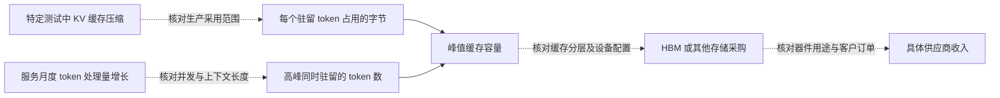

# 推理缓存压缩会削弱 AI 存储需求吗？

以下按 2026 年上半年的公开披露重建三个信息截面。表中的判断为事后复盘。

| 材料公开日 | 当时获得的证据 | 影响哪一步判断 |
| --- | --- | --- |
| 1 月 5 日 | NVIDIA 公布推理上下文存储平台，计划在集群中存放、复用和共享推理缓存。此类缓存保存模型已处理上下文的键和值，即 KV cache。[NVIDIA 平台公告](https://nvidianews.nvidia.com/news/nvidia-bluefield-4-powers-new-class-of-ai-native-storage-infrastructure-for-the-next-frontier-of-ai) | 为同一模型服务估算存储容量时，应先区分 GPU 上的活跃缓存与集群中的可复用缓存。实际部署规模和各层配置仍待核实。 |
| 3 月 24 日 | Google Research 介绍 TurboQuant。在其报告的长上下文检索测试中，KV 缓存占用降至原来的六分之一或更低，检索任务成绩保持满分。[Google Research 实验说明](https://research.google/blog/turboquant-redefining-ai-efficiency-with-extreme-compression/) | 在同类模型、上下文长度和部署条件下，可以下调单次推理所需的缓存容量假设。整机还需存放模型权重等数据，调整 HBM 采购假设前须核实缓存占比、生产采用率及配置。 |
| 5 月 19 日 | Google 披露，旗下服务每月处理的 token 从上年 I/O 时约 480 万亿增至超过 3,200 万亿。[Google I/O 主题演讲](https://blog.google/intl/en-in/company-news/technology/sundar-pichai-io-2026/) | 使用规模增长使另一条路径值得检验：如果高峰时同时驻留的上下文变多，缓存总容量仍可能上升。月度处理量本身无法确定峰值并发、上下文长度或 TurboQuant 的线上部署比例。 |

**截至 5 月 19 日的结论**　在给定工作负载中，压缩使每个驻留 token 需要的字节数下降。要判断线上峰值容量，须再估计同一时刻驻留多少 token。实验中的压缩倍数与服务月度 token 增幅口径不同，直接相除得不出硬件需求的净变化。更新供应商盈利判断前，应进一步取得部署范围、硬件配置和采购证据；兆易创新的 NOR Flash 等业务还需要单独核对产品用途及客户敞口。
